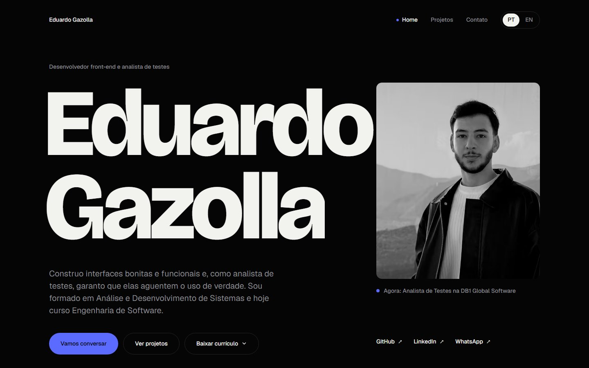

## 💙 Portfólio Eduardo Gazolla

Portfólio pessoal bilíngue (PT-BR/EN) onde mostro meus projetos, experiência e stack. Também tem um formulário de contato e os meus currículos para download.

🔗 **[eduardogazolla.dev](https://eduardogazolla.dev/)**



&nbsp;

## ✨ Destaques

- **Bilíngue:** PT-BR e EN, com troca de idioma sem recarregar a página.
- **Conteúdo via CMS:** projetos, experiências e textos vêm do Hygraph (CMS headless).
- **Contato:** formulário com validação no cliente e no servidor.
- **Currículos para download:** versões QA e Java no idioma da página.
  - Os PDFs são gerados a partir de uma única fonte tipada (`cv/source`).
- **Acessibilidade:** navegação completa por teclado, foco visível, respeito a `prefers-reduced-motion` e verificação automática com axe.
- **Testes:** testes unitários com Jest + Testing Library e testes E2E com Playwright, em desktop e mobile.

&nbsp;

## ⚙️ Tecnologias

- Next.js 16 (App Router) e React 19
- TypeScript
- Tailwind CSS
- Motion
- Hygraph CMS
- React Hook Form + Zod
- Jest + Testing Library
- Playwright + axe-core

&nbsp;

## 🚀 Rodando localmente

```bash
npm ci
cp .env.example .env   # preencha HYGRAPH_URL, HYGRAPH_TOKEN e WEBHOOK_URL
npm run dev            # http://localhost:3000
```

| Comando | O que faz |
|---|---|
| `npm run dev` | Servidor de desenvolvimento |
| `npm run build` | Build de produção |
| `npm run lint` | ESLint |
| `npm test` | Testes unitários (Jest) |
| `npm run test:e2e` | Testes E2E (Playwright: build + servidor na porta 3200) |
| `npm run cv:build` | Gera os PDFs dos currículos em `public/cv` |

&nbsp;

<p align="center">Made with 💙 by Eduardo Gazolla</p>
